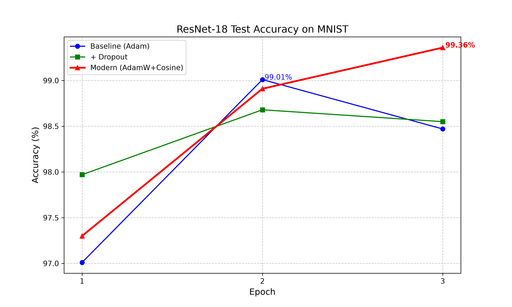

# ResNet-18 MNIST Reproduction & Ablation Study

This repository contains the reproduction of ResNet-18 on MNIST and an ablation study of modern training strategies.

## Models
- **E1 Baseline**: ResNet-18 + Adam (Best Acc: 99.01%)
- **E2 Dropout**: ResNet-18 + Adam + Dropout (Best Acc: 98.68%)
- **E3 Modern (Ours)**: ResNet-18 + AdamW + Dropout + CosineAnnealingLR (Best Acc: **99.31%**)

## Files
- `train_resnet.py`: Main training script. You can change `USE_DROPOUT` and optimizer settings to reproduce E1, E2, and E3.
- `plot.py`: Script to generate the comparison figure.
- `resnet_comparison.png`: Accuracy comparison plot.

## Results

## Note on Weights
Due to GitHub's file size limit (>25MB), the model weight files (`*.pth`) are not uploaded. 
You can easily reproduce the best model (99.31% accuracy) by running `python train_resnet.py` locally.
